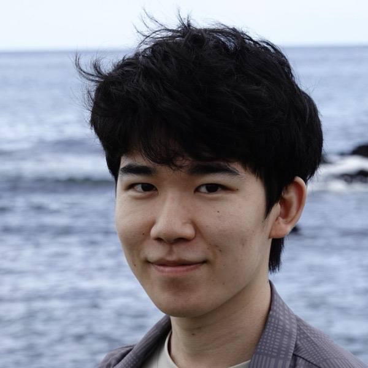

  

# Ryota Takatsuki

高槻 瞭大



I am a Ph.D. student at [Sussex Centre for Consciousness Science](https://www.sussex.ac.uk/research/centres/sussex-centre-for-consciousness-science/), University of Sussex, supervised by [Anil Seth](https://www.anilseth.com/) and [Christopher Buckley](https://christopherlbuckley.com/), and a research fellow at [AI Alignment Network](https://www.aialign.net/) in Tokyo.
  

  

My research develops an interpretability-driven approach to consciousness science. I use transformer-based language, vision, and vision–language models as comparative experimental systems: they can be tested with the same kinds of stimuli as human participants, while their internal states can be recorded and manipulated in ways that brains do not allow. My work asks whether these models exhibit consciousness-associated phenomena, such as bistable perception and metacognition, and uses mechanistic interpretability to characterize how they are implemented. What recurs across very different models points to constraints set by the problem itself, while what varies shows which aspects of the human case are one option among several. Understanding the computational aspects of consciousness in this way can refine theories, motivate new human experiments, and ultimately help us better assess consciousness in other systems.

Before Sussex, I was a research intern in [Ryota Kanai](https://research.araya.org/member/ryota-kanai-phd)'s research team at Araya Inc., where I worked on meta-representations as a way of operationalizing higher-order theories of consciousness for deep learning models, alongside the mechanistic interpretability of visual illusions. I also studied bistable perception in multimodal models at the [R&D Center for Large Language Models](https://llmc.nii.ac.jp/en/), National Institute of Informatics, and real-time 3D video transmission at the University of Tokyo, where I completed my B.S. in Engineering (Systems Innovation).

## News



## Selected publications



[All publications and presentations →](/publications/)
